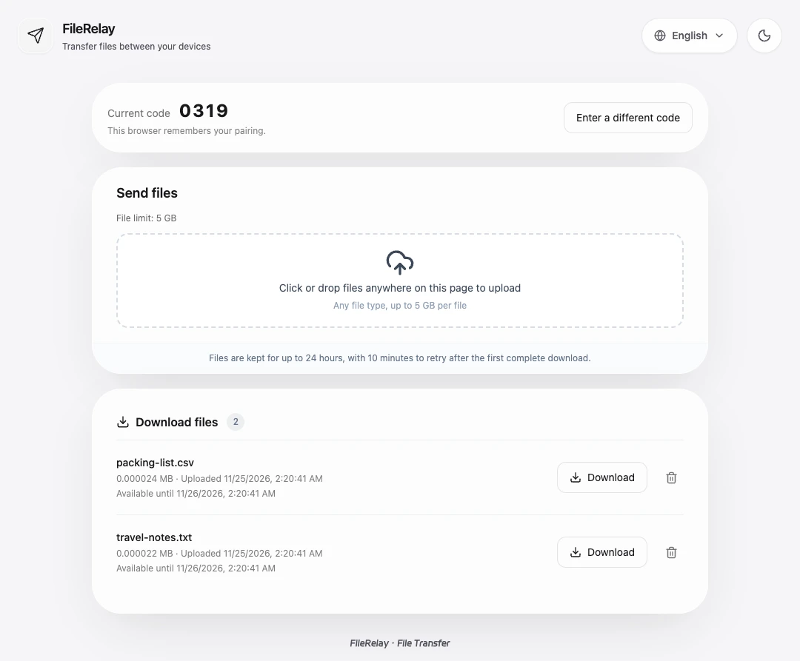

<div align="center">


# FileRelay

### 同一个口令，手机和电脑都能收发文件。

用浏览器配对，上传的文件会自动出现在另一台设备上。<br />
服务可部署在自己的服务器或 NAS 上，文件到期自动清理。

**[快速开始](#快速开始)**　·　[部署文档](./docs/guide/filerelay.md)　·　[反馈问题](https://github.com/BusqinTulga/file-relay/issues)

[](./LICENSE)
[](./docker-compose.yml)
[](./frontend/)
[](./main.py)

[简体中文](#中文)　/　[English](#english)　/　[日本語](#日本語)

<br />



</div>

---

## 中文

FileRelay 是一个自托管的临时文件中转工具，适合在手机、电脑和平板之间传照片、文档和其他文件。打开同一站点就能收发，无需安装客户端。

### 功能

- **口令配对**　前两台设备输入相同的 1–4 位数字口令即可配对。从第三台起，需要已配对设备确认。浏览器会记住配对。
- **双向收发**　支持多文件上传、逐文件进度和断点续传。共享列表自动更新，通过浏览器直接下载。
- **自动清理**　文件上传后最多保留 24 小时。服务器首次完整发送后，文件最多再保留 10 分钟供重试，以两个期限中较早的一个为准。
- **容量管理**　新安装默认单文件 5 GB、全站 500 GB。管理员可以调低上限、暂停上传，并在后台查看容量和文件。
- **三语界面**　支持简体中文、英语和日语。

### 快速开始

```sh
git clone https://github.com/BusqinTulga/file-relay.git
cd file-relay
APP_ENV=development docker compose up -d --build
```

在运行 Docker 的机器上打开 [http://localhost:12345](http://localhost:12345)，按提示设置管理员密码。管理后台位于 `/admin/dashboard`。

默认生产模式支持 HTTP 和 HTTPS，同一域名或 IP 上可共用配对 Cookie。HTTPS 由反向代理提供，仅允许 HTTPS Cookie 时可设置 `FILERELAY_ALLOW_HTTP=false`。Docker 数据卷 `relay-data` 持久化保存文件和 SQLite 数据库。

### 技术栈与文档

- 前端使用 Vue 3、TypeScript 和 Vite，后端使用 FastAPI、SQLite 和本地文件存储，以单 worker 运行。
- [部署、开发、备份与升级](./docs/guide/filerelay.md) · [Relay API](./docs/api/relay.md)

---

## English

FileRelay is a self-hosted tool for moving photos, documents, and other files between phones, computers, and tablets. Open the same site on each device to send and receive files in the browser.

### Features

- **Code pairing.** Enter the same 1–4 digit code on the first two devices. Additional devices need approval from a paired device. Your browser remembers the pairing.
- **Two-way transfers.** Upload multiple files with per-file progress and resumable uploads. The shared list updates automatically, and downloads use the browser’s built-in download manager.
- **Automatic cleanup.** Files expire 24 hours after upload or 10 minutes after the server first finishes sending them, whichever comes first. The 10-minute window allows download retries.
- **Storage controls.** New installations default to 5 GB per file and 500 GB in total. Administrators can lower the limits, pause uploads, and see files and storage usage in the admin console.
- **Three interface languages.** Simplified Chinese, English, and Japanese.

### Getting started

```sh
git clone https://github.com/BusqinTulga/file-relay.git
cd file-relay
APP_ENV=development docker compose up -d --build
```

On the machine running Docker, open [http://localhost:12345](http://localhost:12345) and follow the prompts to set an administrator password. The admin console is at `/admin/dashboard`.

Production mode supports HTTP and HTTPS by default. Pairing cookies can be shared across both protocols on the same hostname or IP address. Serve HTTPS through a reverse proxy and set `FILERELAY_ALLOW_HTTP=false` if pairing cookies should require HTTPS. The `relay-data` Docker volume persists the files and SQLite database.

### Tech stack and docs

- Vue 3, TypeScript, and Vite on the frontend. FastAPI, SQLite, and local file storage on the backend, with one worker.
- [Deployment, development, backups, and upgrades (Chinese)](./docs/guide/filerelay.md) · [Relay API (Chinese)](./docs/api/relay.md)

---

## 日本語

FileRelay は、スマートフォンやパソコン、タブレットの間で写真や書類などを一時的に受け渡すためのセルフホスト型ツールです。各端末で同じサイトを開けば、ブラウザからファイルを送受信できます。

### 機能

- **コードでペアリング**　最初の2台は、同じ1〜4桁の数字を入力すると接続できます。3台目以降はペアリング済みの端末で承認します。ペアリングはブラウザに保存されます。
- **双方向のファイル転送**　複数ファイルのアップロード、ファイルごとの進捗表示、中断したアップロードの再開に対応しています。共有一覧は自動で更新され、ブラウザの標準機能でダウンロードできます。
- **自動削除**　ファイルの有効期限は、アップロードから24時間後と、サーバーが初回のファイル送信を完了してから10分後のうち、いずれか早い方です。送信完了後も有効期限までは再ダウンロードできます。
- **容量管理**　新規インストール時の上限は1ファイルあたり5 GB、サイト全体で500 GBです。管理画面では、上限の引き下げ、アップロードの停止、ファイルや使用容量の確認ができます。
- **3言語対応**　日本語、英語、簡体字中国語のインターフェースを利用できます。

### はじめかた

```sh
git clone https://github.com/BusqinTulga/file-relay.git
cd file-relay
APP_ENV=development docker compose up -d --build
```

Docker を実行しているマシンで [http://localhost:12345](http://localhost:12345) を開き、画面の案内に従って管理者パスワードを設定します。管理画面は `/admin/dashboard` です。

本番モードでは既定で HTTP と HTTPS の両方を利用でき、同じホスト名または IP アドレスでペアリング Cookie を共有できます。HTTPS はリバースプロキシで提供し、ペアリング Cookie を HTTPS に限定する場合は `FILERELAY_ALLOW_HTTP=false` を設定します。ファイルと SQLite データベースは Docker ボリューム `relay-data` に保存されます。

### 技術スタックとドキュメント

- フロントエンドは Vue 3、TypeScript、Vite を使用します。バックエンドは FastAPI、SQLite、ローカルストレージを使用し、1ワーカーで動作します。
- [デプロイ・開発・バックアップ・アップグレードガイド（中国語）](./docs/guide/filerelay.md) · [Relay API（中国語）](./docs/api/relay.md)

---

## 许可 / License / ライセンス

FileRelay 基于 FileCodeBox 改造，保留上游作者信息及许可证。<br />
FileRelay is based on FileCodeBox and retains the upstream author attribution and license.<br />
FileRelay は FileCodeBox をベースにしており、元の著作者表記とライセンスを引き継いでいます。

[FileCodeBox](https://github.com/vastsa/FileCodeBox)　·　[LGPL-3.0](./LICENSE)
